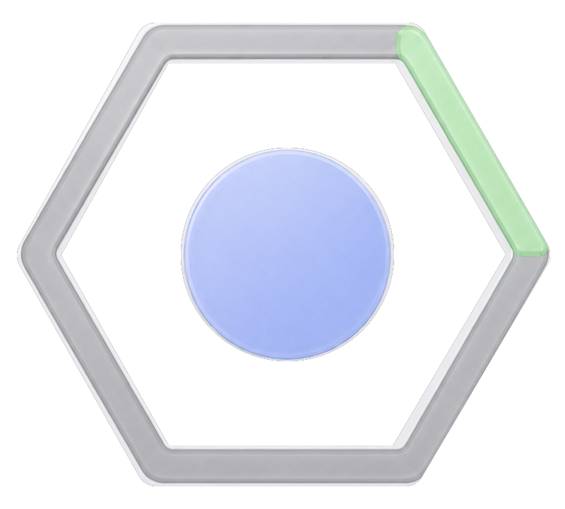

<p></p>

[English](PRIVACY.md) · [简体中文](PRIVACY.zh-CN.md)

# Privacy

Last updated: October 13, 2026

Scope: **Cohex 1.0.0 (6)**. SSH tasks and in-app updating are disabled in this
release.

Cohex is a local macOS utility. It does not include developer analytics, advertising, a crash-reporting upload service, or a developer-operated remote backend.

## Data processed locally

Cohex processes only the information needed to respond to pointer/trackpad and optional controller input, and render local status and Statistics:

- Local pointer positions, press/release and pressure events needed for gestures. Global pressure is opt-in and targets the built-in MacBook trackpad. The guide uses synthetic tasks and numbers.
- Nintendo Switch Pro Controller button, trigger, and stick events received through Apple's `GameController` framework. A narrow, non-seizing HID fallback listens only for Nintendo Pro Controller L3/R3 button usages when macOS omits those optional objects.
- Codex Desktop shortcut and application state needed to direct documented keyboard events and `codex://` links to the running Codex process.
- Bounded Accessibility semantics from verified Codex windows, such as control role, enabled/visible state, labels needed to identify an action, current model/Reasoning labels, task identity, composer caret/value for guarded text operations, and geometric control information.
- Read-only Codex metadata under `~/.codex`, including the local task index, global UI state, model catalog, keyboard-shortcut configuration, bounded rollout lifecycle/token metadata, opaque request call identifiers, and the `sandbox_permissions` enum needed to match an escalated-permission request with its completion in memory.

Accessibility discovery can encounter short visible text while identifying an actionable control. The aggregate local generation rate does not require current-task identity. Retained compatibility paths may compare one complete title with a read-only name catalog; such a match cannot authorize navigation or commands. A separate completion-only path compares a complete current label from the unique primary system document title or an explicitly current sidebar row against the full available name catalogs, including Remote names outside the displayed wheel, to manage Cohex's in-memory completion reading session. It requires complete readable catalogs and an unambiguous Host + Task; it cannot grant routing or command authority, admit tasks, or write Desktop account unread state. The document path reads only AX role, visibility, shell URL, title and task-composer metadata; it does not read composer values or conversation content. URL query/fragment values are not used for identity, retained or logged. Root title subscriptions are bounded and event-driven, and do not expand the sidebar. Labels, collision indexes, viewing sessions and match decisions remain in memory and are not logged or persisted. Support reports expose only fixed rejection reasons and anonymous counts. Cohex does not intentionally retain conversation bodies, copy composer text through the clipboard, or persist message content. Dictation remains owned by Codex Desktop; Cohex does not capture a composer draft or attempt to restore transcribed text. The Plan-document bridge reads only bounded control metadata such as role, identifier, title, description, enabled state, and frame so it can identify one exact open action or verify the right-side Plan panel. It does not read or retain the Plan body. The rollout readers parse lifecycle, model, token, rate-limit, and task metadata rather than message bodies. For native questions and escalated-tool lifecycle matching, the activity reader decodes only the structural response-item timestamp, type, function name, opaque call ID, and the `sandbox_permissions` enum needed to distinguish `require_escalated`; it deliberately omits command text, justification, general arguments, question text, options, answers and output values. Async question status additionally extracts only the bounded question count, source item/call ID, question indices and the tool acknowledgement’s `accepted` boolean. In accepted user reply records, it recognizes the exact question-reply wrapper and decodes only its structural `questionItemId`; question and answer values are skipped and no general message body is retained. An open escalated-tool call is never treated as a user-visible question. Call IDs and the resulting ledgers remain in memory, are cleared at generation/runtime/file boundaries, and are not logged or persisted.

Once per new Codex runtime, Cohex may inspect the structural lifecycle metadata of all indexed root-user rollouts so running Tasks older than the ordinary recent catalog are not omitted. That bootstrap has byte and wall-clock limits, and an interrupted or incomplete record is not published as authority; normal operation then returns to bounded event-driven following. A newly indexed root rollout, or an active rollout whose physical file continuity was lost, may receive one exact UUID-checked structural reverse bootstrap before following resumes. This does not replay historical token rows as live speed. The current visible Task may also receive one bounded latest-two-token-sample read to establish its live-rate baseline. None of these operations installs a recurring scan. Existing calibration intervals may be reused for a simple active-use hours estimate. Local Statistics retains only the numeric summaries and hashed continuity metadata described below; it does not retain raw rollout events or Task identities.

The structural rollout bootstrap's exact limits are 32 MiB of reverse scanning
per file and one shared 2 s wall-clock deadline per pass.

## Data stored by Cohex

The active controller profile is stored at:

```text
~/Library/Application Support/Cohex/profile.json
```

On first launch, Cohex may read the legacy local preference domain
`com.ranwang.CodexController` and
`~/Library/Application Support/CodexController/profile.json` to import only a
validated mapping profile, language choice, and Monitor position. It does not
delete or overwrite the legacy files, and it does not import live task state,
token data, or experimental connection state.

It contains mappings, Skill favorites, feedback preferences, and the task-state color palette. Standard macOS preferences store small device-local UI settings, including the Token Monitor's display-relative position and the default-off choice to show SSH Tasks in Recent 6. That SSH choice is not included in profile import or export.

Live token-rate frames, raw rate-limit snapshots, task activity events, task titles, and the six-slot status projection remain in memory. Exported mapping profiles are written only to a location the user chooses.

### Local Statistics

Statistics stores a private SQLite database at:

```text
~/Library/Application Support/Cohex/usage-statistics-v1.sqlite
```

Schema version 1 stores UTC 15-minute numeric buckets, quota-cycle summaries,
and replay checkpoints. Buckets and summaries contain generated Token counts,
covered work duration, Token counts and duration eligible for an average rate,
quota percentages and timestamps, cycle/reset boundaries, an estimated yield
when available, and flags describing gaps or unverified history. They contain
no raw telemetry events, prompts, answers, conversation bodies, commands, or
file contents.

Account/quota scopes, source counter keys, Turn matching keys, and file
continuity fingerprints use SHA-256 hashes. The database stores no raw account,
Host, Task, or Turn identifiers, names, rollout paths, credentials, or source
files. Hashed watermarks retain numeric counter baselines, offsets, generation
numbers, and observation timestamps to avoid counting replayed data twice.
These hashes allow local continuity matching; they are not uploaded.

Numeric history and its replay metadata have no automatic age-based expiry or
history deletion. Storage can grow with use. Cohex uses incremental transactions
and keeps the database and its SQLite journal files at owner-only permissions
(`0600`) inside its private support directory (`0700`). It does not recreate a
corrupt database or silently replace unreadable history with an empty store.
Statistics uses the existing local telemetry pipeline and does not add a
background upload service. Support diagnostics expose only store status and
fixed-reason occurrence counts, not stored usage values, identities, or times.

To remove Statistics history, quit Cohex and delete the database together with
any `usage-statistics-v1.sqlite-wal`, `usage-statistics-v1.sqlite-shm`, and
`usage-statistics-v1.sqlite-journal` files in the same directory. Removing the
entire Cohex support directory also removes that history.

## Network behavior

Cohex does not send data to a developer service. Its normal shortcuts,
Accessibility integration, local database reads, rollout reads, and Token
Monitor remain local.

SSH is disabled by the 1.0 release gate. Stored preferences are retained, but
Cohex does not start SSH connections, remote catalogs or remote navigation.
Dormant compatibility implementations do not authorize networking in this release.

In-app updates are also disabled in all 1.0 build modes. Cohex does
not initialize a production update feed, check for updates or download an
update. Manual downloads from GitHub Releases take place in the user's browser;
GitHub receives normal network metadata for those requests.

The public website uses local static assets and fixed anonymous examples.
Its optional language choice is stored in that browser's localStorage. It does
not read local tasks or usage data, load an analytics SDK, or send telemetry.

## Permissions

Cohex requests macOS Accessibility permission because some Codex actions do not have a documented shortcut or deep link. macOS presents and controls this permission; the app cannot approve itself.

The app does not request microphone permission. ZR holds Codex Desktop's dictation shortcut, and Codex Desktop owns any microphone permission and audio processing. While ZR owns an active or asynchronously starting dictation session, Cohex consumes B as a no-op so Escape cannot interrupt the native recording. After ZR is released, B returns to its ordinary Escape behavior. Cohex does not record audio, retain a composer draft, or restore dictation text.

Game controller access normally does not present a separate privacy prompt. The Nintendo stick-click fallback is a local HID input operation.

Cohex does not patch Codex, modify its ASAR, use private Electron IPC, emulate
Work Louder hardware, or execute user-supplied shell commands. Dormant remote
transport paths remain disabled by the release gate.

## Removing local data

Quit Cohex, remove the app from `/Applications`, and optionally delete:

```text
~/Library/Application Support/Cohex
~/Library/Preferences/com.ranwang.Cohex.plist
```

Remove Cohex from System Settings → Privacy & Security → Accessibility, and Input Monitoring if granted, to revoke those permissions. Do not delete `~/.codex`; that directory belongs to Codex Desktop and contains the user's Codex data.

## Support disclosures

When reporting a problem, do not upload conversations, credentials, complete `~/.codex` files, task identifiers, account quota values, or other private work. See [SUPPORT.md](SUPPORT.md) for the minimal diagnostic information that is useful.

## Usage tutorial and software updates

The tutorial uses fixed example tasks and numbers. It stores only selected language, completed/deferred tutorial version and a one-time upgrade-notice version. Pressure factory profile v1 stores only its numeric version; it contains no device identifier or calibration samples.

SSH and updater controls remain gray and unavailable. Existing SSH preferences are retained without enabling runtime connections.

The updater does not contact an appcast or download service in this release.
No task names, task IDs, local paths, Statistics history, account data or support
reports are sent for update checking. Any future updater-enabled release must
state its network behavior separately before it is offered.
